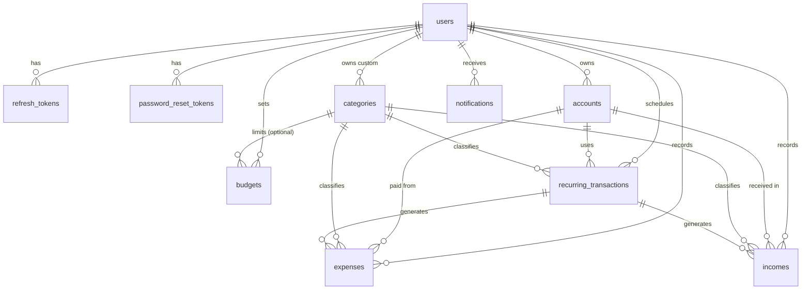

# Database Schema

PostgreSQL 15+ (developed on 18). Schema is created by plain SQL files in
`backend/database/migrations/`, applied in filename order by `backend/database/migrate.js`.

## Commands (run inside `backend/`)

| Command                  | What it does                                                        |
| ------------------------ | ------------------------------------------------------------------- |
| `npm run migrate`        | Apply all pending migrations (each in its own transaction)          |
| `npm run migrate:status` | Show each migration as `applied`, `pending` or `MODIFIED`           |
| `npm run migrate:reset`  | Drop everything and re-apply (development only, refused in production) |
| `npm run seed`           | Insert the 16 default categories (safe to re-run, any environment)  |
| `npm run seed:demo`      | Default categories + demo user and ~3 months of sample data         |

Demo login: `demo@expensetracker.local` / `Demo@12345` (demo seeding is refused when `NODE_ENV=production`).

**Rule:** never edit a migration that has been applied. The runner stores a SHA-256 checksum and
stops if a file changes. Add a new numbered migration instead (`011_...sql`).

## ER diagram

## Conventions

- Primary keys are `UUID` (`gen_random_uuid()`).
- Money is `NUMERIC(12,2)`, never float. Amounts are always positive; the table
  (`expenses` vs `incomes`) gives the direction.
- Timestamps are `TIMESTAMPTZ`; transaction dates are `DATE`.
- `updated_at` is maintained by the `set_updated_at()` trigger (users, expenses, incomes,
  recurring_transactions).
- Allowed values are enforced with `CHECK` constraints (listed below), so bad data is rejected
  by the database even if the API has a bug.
- Account balance = opening balance + incomes - expenses. The app updates it inside a database
  transaction (Phase 4).

## Tables

### users
| Column | Type | Notes |
| --- | --- | --- |
| id | uuid PK | |
| name | varchar(100) | |
| email | varchar(255) | unique, case-insensitive (`users_email_unique` on `LOWER(email)`) |
| password_hash | varchar(255) | bcrypt |
| avatar_url | text | nullable |
| currency | char(3) | default `USD`, must be 3 capital letters |
| language | varchar(5) | `en` or `ar`, default `en` |
| theme | varchar(10) | `light`, `dark`, `system`; default `system` |
| role | varchar(10) | `user` or `admin`; default `user` |
| email_verified | boolean | default false |
| created_at / updated_at | timestamptz | |

### refresh_tokens
`id`, `user_id` (FK users, CASCADE), `token_hash` (unique, only the hash is stored),
`expires_at`, `revoked` (default false), `created_at`.

### password_reset_tokens  *(added; not in the original table list)*
`id`, `user_id` (FK users, CASCADE), `token_hash` (unique), `expires_at`, `used_at` (null until
used, makes the token single-use), `created_at`. Needed for task 3.5.

### accounts
| Column | Type | Notes |
| --- | --- | --- |
| id | uuid PK | |
| user_id | uuid FK users | CASCADE |
| name | varchar(100) | unique per user |
| type | varchar(10) | `cash`, `bank`, `card`, `savings` |
| balance | numeric(12,2) | default 0, may be negative (e.g. a credit card) |
| currency | char(3) | |
| color | varchar(7) | `#RRGGBB` |
| is_archived | boolean | default false |
| created_at | timestamptz | |

### categories
| Column | Type | Notes |
| --- | --- | --- |
| id | uuid PK | |
| user_id | uuid FK users, nullable | NULL = default category shared by everyone |
| name | varchar(60) | |
| type | varchar(10) | `income` or `expense` |
| icon | varchar(50) | icon name for the frontend |
| color | varchar(7) | `#RRGGBB` |
| is_default | boolean | must be true exactly when `user_id` is NULL |

Uniqueness (case-insensitive name per type): one partial index for defaults, one per user.

### expenses
| Column | Type | Notes |
| --- | --- | --- |
| id | uuid PK | |
| user_id | uuid FK users | CASCADE |
| account_id | uuid FK accounts | NO ACTION: an account with expenses cannot be deleted |
| category_id | uuid FK categories | NO ACTION: same for categories |
| amount | numeric(12,2) | must be > 0 |
| date | date | default today |
| note | text | |
| payment_method | varchar(20) | `cash`, `card`, `bank_transfer`, `mobile_wallet`, `other` |
| tags | text[] | default `{}`, GIN indexed |
| receipt_url | text | |
| recurring_id | uuid FK recurring_transactions | SET NULL when the template is deleted |
| created_at / updated_at | timestamptz | |

### incomes
Same shape as expenses, with `source varchar(150)` instead of `payment_method`/`tags`/`receipt_url`.

### budgets
| Column | Type | Notes |
| --- | --- | --- |
| id | uuid PK | |
| user_id | uuid FK users | CASCADE |
| category_id | uuid FK categories, nullable | NULL = overall budget; CASCADE |
| amount | numeric(12,2) | > 0 |
| month / year | smallint | 1-12 / 2000-2100 |
| alert_threshold | smallint | 1-100, default 80 (percent) |
| created_at | timestamptz | |

One budget per user + category + month + year. Two partial unique indexes are used because
`NULL` values are never equal in a normal `UNIQUE` constraint.

### recurring_transactions
`id`, `user_id`, `type` (`income`/`expense`), `amount` (> 0), `account_id`, `category_id`,
`frequency` (`daily`/`weekly`/`monthly`/`yearly`), `start_date`, `end_date` (nullable, must be
>= start_date), `next_run_date`, `is_active` (default true), plus `note`, `created_at`,
`updated_at` (small additions so generated transactions can copy the note).

### notifications
`id`, `user_id`, `type` (`budget_warning`, `budget_exceeded`, `recurring_created`,
`weekly_summary`, `system`), `title`, `message`, `is_read` (default false), `created_at`.

### schema_migrations
Created by the runner: `filename` (PK), `checksum`, `applied_at`.

## Delete behaviour (summary)

- Deleting a **user** removes everything they own (all user-owned FKs are `CASCADE`).
- Deleting an **account or category that still has transactions** is blocked by the database
  (`NO ACTION`). The API should check first and return a friendly error (Phase 4).
- Deleting a **recurring template** keeps the expenses/incomes it already created.
- Deleting a **custom category** removes its budgets.

## Indexes (migration 010)

| Table | Indexes |
| --- | --- |
| expenses | `(user_id, date DESC)`, `(user_id, category_id)`, `account_id`, `category_id`, `recurring_id` (partial), GIN `tags` |
| incomes | same as expenses, without tags |
| accounts / categories | `user_id` |
| budgets | `category_id` (partial) + the two unique indexes |
| recurring_transactions | `next_run_date` where active (daily job), `user_id`, `account_id`, `category_id` |
| notifications | `(user_id, created_at DESC)`, `user_id` where unread (bell badge) |
| refresh_tokens | `user_id`, `expires_at` |
| password_reset_tokens | `user_id` |

Foreign-key columns are indexed so deletes and joins stay fast.

## Seed data

- `001_default_categories.sql`: 11 expense categories (Food, Transport, Rent, Bills, Shopping,
  Health, Entertainment, Education, Travel, Gifts, Other) and 5 income categories (Salary,
  Freelance, Gifts, Investments, Other). Re-runnable.
- `002_demo_data.sql`: demo user, 4 accounts, about 3 months of expenses and incomes (dates
  relative to today), budgets for the current month, 3 recurring templates, 2 notifications.
  Account balances are recalculated so they match the transactions. Re-runnable.
